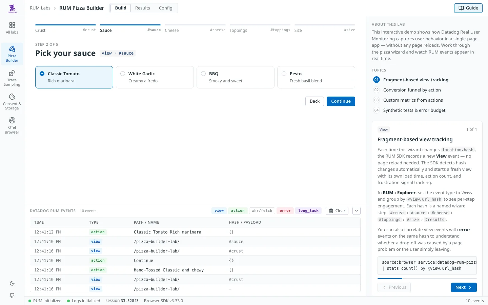
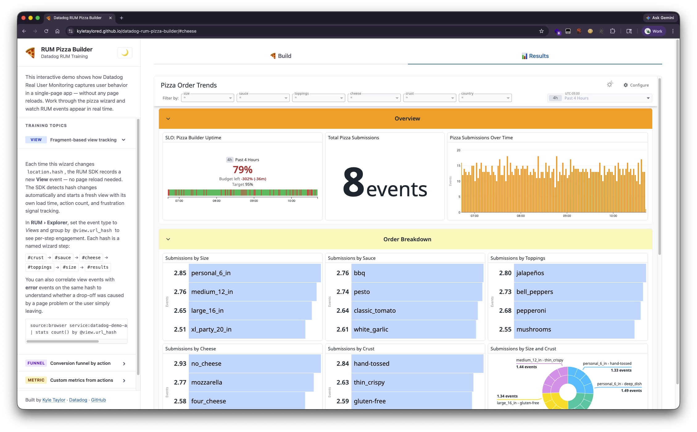

# 🍕 Datadog RUM Pizza Builder

A self-contained demo app for exploring [Datadog Real User Monitoring (RUM)](https://docs.datadoghq.com/real_user_monitoring/) — built as an interactive pizza order wizard.

**[Live Demo →](%%PAGES_URL%%/)**



---

## Results dashboard

The Results tab embeds a live Datadog dashboard showing metric charts for pizza order submissions — broken down by crust, sauce, cheese, toppings, size, and geography.



---

## What this demonstrates

This app is designed as a hands-on training tool to show how Datadog RUM captures user behavior in a single-page app using URL fragment-based navigation.

### Views

Each wizard step updates the URL hash, triggering a new RUM view:

| Step     | Fragment    |
| -------- | ----------- |
| Crust    | `#crust`    |
| Sauce    | `#sauce`    |
| Cheese   | `#cheese`   |
| Toppings | `#toppings` |
| Size     | `#size`     |
| Results  | `#results`  |

In the RUM Explorer, these appear as distinct views with their own load times, action counts, and frustration signals — even though no page navigation occurred.

### Actions

RUM auto-captures clicks (e.g. "Continue", "Start Over") as `click` actions. The final step also fires a **custom action**:

```javascript
DD_RUM.addAction("pizza_order_submitted", {
  pizza_order: {
    crust: "Hand-Tossed",
    sauce: "BBQ",
    cheese: "Mozzarella",
    toppings: "Pepperoni",
    size: "Large (16 in)",
  },
});
```

In the RUM Explorer, filter by `@action.target.name:pizza_order_submitted` and use `@context.pizza_order.*` attributes as facets to see the full order payload.

### User tracking

When an order is submitted, the app calls `DD_RUM.setUser()` with a generated name, email, and a deterministic ID hashed from those values:

```javascript
DD_RUM.setUser({
  id: "3291847650",
  name: "Alex Smith",
  email: "alex.smith@example.com",
});
```

The ID is an idempotent djb2 hash of name + email — the same fictional person always gets the same ID, simulating a returning user across sessions. In the RUM Explorer, filter by `@usr.id`, `@usr.name`, or `@usr.email` to see all sessions for a given user.

### Error collection

The app collects errors in two ways:

- **Automatic** — `console.error()` calls are captured by the RUM SDK as error events with `source:console`. The synthetic error injection uses this path so no custom instrumentation is needed.
- **Automatic** — unhandled exceptions are captured as `source:source` errors.

In the RUM Explorer, filter by `@error.source:console` to see the synthetic injection errors.

### `beforeSend` callback

The RUM SDK is initialized with a `beforeSend` callback that intercepts every event before it's sent to Datadog. The demo uses this to power the live event log table at the bottom of the page — showing event type, view path, URL hash, action names, and context payloads in real time.

```javascript
beforeSend: (event) => {
  logRumEvent(event); // feeds the on-page event table
  return true; // always forward to Datadog
};
```

Returning `false` from `beforeSend` would discard the event. See the [Datadog docs](https://docs.datadoghq.com/real_user_monitoring/guide/enrich-and-control-rum-data/?tab=npm) for enrichment and filtering patterns.

### Session lifecycle

Clicking **Start Over** calls `DD_RUM.stopSession()`, ending the current RUM session. A new session begins on the next user interaction. This is useful for demonstrating session boundaries in training scenarios.

### Synthetic tests & SLO

A Datadog Browser Synthetic test runs against this app on a schedule, simulating the full wizard flow from start to finish. To generate varied data, the app detects the `DatadogSynthetics` user agent and randomizes the option order on each step — so the test always clicks the first card but gets a different pizza every run.

On ~20% of runs a simulated JS error is injected at a random step (2–5), blocking the test from completing. This intentionally produces a realistic mix of pass and fail results across the funnel. The session is tagged with `@context.synthetic.will_fail` and `@context.synthetic.intended_fail_step` via `setGlobalContext` so you can filter for intentional failures in the RUM Explorer.

An **SLO** is built on the synthetic monitor to track wizard completion rate over a rolling 7-day window. The Results dashboard includes an SLO widget showing current status and remaining error budget. A breach indicates something is broken beyond the expected noise level — correlate with the RUM funnel and session replays to investigate.

---

## Consent & Storage Lab

**[Try it →](%%PAGES_URL%%/consent-lab/)**

A second, standalone demo at `/consent-lab/` for a real recurring sales-engineering question: an EU customer's legal team won't allow *any* cookie — including RUM's first-party session cookie — without prior consent, but they still want 100% error capture and don't want session counts inflated by a multi-tab, refresh-heavy flow.

It demonstrates, live in the browser:

- **`sessionPersistence: 'cookie' | 'local-storage' | 'memory'`** — a live storage inspector shows exactly what RUM writes to `document.cookie` and `localStorage` under each mode.
- **`setTrackingConsent('pending' | 'granted' | 'not-granted')`** — a consent banner gates RUM end-to-end; nothing is written or sent until the user accepts.
- **Multi-tab / refresh session stability** — a `BroadcastChannel` compares the live RUM session ID across every open tab, showing why `memory` persistence risks inflating session counts for multi-tab flows (a new session per tab, and per refresh) while `local-storage` doesn't.
- **An always-on error pipe, independent of consent** — the Logs Browser SDK runs from first paint with `forwardErrorsToLogs: true` regardless of RUM's consent state, so 100% of errors are captured before anyone clicks anything.
- **An error-source coverage matrix** — the part that's easy to get wrong. An error log leaving the Logs SDK does *not* necessarily become an Error Tracking issue, and browser errors have two separate front doors with different requirements: [Frontend Error Tracking](https://docs.datadoghq.com/error_tracking/frontend/browser/) is fed by the **RUM** SDK and is therefore consent-gated, while [Error Tracking for Logs](https://docs.datadoghq.com/error_tracking/frontend/logs/) is fed by the **Logs** SDK and is the door that works pre-consent. The matrix fires ten error sources and reports, per door, what each SDK actually built — measured out of `beforeSend`, not asserted. The near-misses are the interesting rows: `console.error("string")`, `logger.error("message")` and passing a string where the `Error` belongs all produce a healthy-looking `status:error` log with no usable stack, so none become issues — a pattern that shows up anywhere logging call sites accept a plain string instead of an `Error`.
- **A "Generate error" button** — reports one real `Error` into both pipes at once (`logger.error(msg, ctx, err)` and `DD_RUM.addError(err)`), which is the shape that satisfies Error Tracking on both sides.
- **The recommended shape for strict-consent deployments — and the trap in front of it.** "Cookie-free Logs, cookie-based RUM after consent" is the natural reading of the requirement, but it doesn't work: both SDKs on a page share one session manager and one `_dd_s` store, so configuring them with different `sessionPersistence` values leaves RUM unable to establish a session, sending nothing at all, with no exception and no console warning. The lab demonstrates this, and in `cookie` mode the Storage Inspector shows the single shared `_dd_s` carrying `logs=1&rum=1`. The working shape puts **both SDKs on `local-storage`** and gates only RUM via `trackingConsent` — no cookie at any point, no inflated session counts (unlike `memory`, `local-storage` survives refreshes and is shared across tabs), and no pre-consent coverage gap.

The lab also calls out an important caveat: switching to `local-storage` removes an HTTP cookie, but the EU ePrivacy Directive's "storage on terminal equipment" language is read by some regulators as covering *any* client-side storage, not just cookies. It's framed in the UI as a mitigation to confirm with legal/DPO, not a guaranteed compliance fix.

---

## Trace Sampling Lab

**[Try it →](%%PAGES_URL%%/trace-sampling-lab/)**

A lab at `/trace-sampling-lab/` on how two RUM options, `traceSampleRate` and `traceContextInjection`, decide which browser requests end up as backend traces in Datadog, and which of those link back to RUM. It fires real `fetch` calls through the real RUM SDK. A service worker stands in for the backend, so it runs on GitHub Pages with no server.

- **A guided walkthrough.** The *Try it live* tab follows one request's trip in four steps: pick a scenario, set the backend's rate, send requests, read what happened. The three classic scenarios are one click each: keep everything (`100` / `'all'`), browser says drop (`0` / `'all'`) and backend decides the rest (`20` / `'sampled'`). A plain-language summary and a docked request-by-request table show what the browser attached, what the pretend backend did with it, and whether RUM's resource event carries the same `_dd.trace_id` as the kept trace. The same requests are in devtools › Network.
- **Per session, not per request.** The SDK hashes the session ID to make the trace decision, so at `traceSampleRate: 20` a single session sends priority 1 on every request or on none. The 20% only shows up across sessions. A **Start a new RUM session** button and a per-session table make that visible.
- **A ReactFlow model.** The *See the big picture* tab draws both `traceContextInjection` routes on one graph, with `sessionSampleRate`, `traceSampleRate` and `DD_TRACE_SAMPLE_RATE` sliders. It shows how many of N requests become traces linked to RUM, traces that exist only in the backend, or nothing.

---

## Running locally

Every environment — this home page and each lab directory — builds from the one `package.json` at the repo root:

```bash
npm install
cp config.template.js config.js   # fill in your applicationId + clientToken
npm run dev                        # serve the repo root at http://localhost:8765, rebuilding lab bundles on change
```

| Command | What it does |
| --- | --- |
| `npm run dev` | Watches every lab bundle and serves the repo root with caching disabled — edit and reload |
| `npm run build` | Builds every environment into `_site/`: bundles, `config.js`, URL templating, cache-busting, source maps, validation |
| `npm run preview` | `build`, then serves `_site/` exactly as it will be deployed |
| `npm run labs` | Lists the environments the build discovered |
| `npm run proxy` | Starts the [OTel lab](otel-rum-lab/)'s optional local OTLP proxy |
| `npm run sourcemaps:upload` | Uploads `_site/`'s source maps to Datadog (needs `DATADOG_API_KEY` and `PAGES_URL`) |

Environments are discovered, not listed: the root plus any top-level directory with an `index.html` is one, and a lab with a `src/main.js` gets it bundled by esbuild into `<lab>/dist/bundle.js`. Adding a lab needs no build or workflow change. See [`scripts/build.js`](scripts/build.js) for every step.

`npm run build` reads `DD_APP_ID` / `DD_CLIENT_TOKEN` from the environment and falls back to your local `config.js`; `PAGES_URL`, `VERSION`, and `GITHUB_REPOSITORY` are optional.

---

## Deployment

This repo is deployed via **GitHub Pages** by [the Pages workflow](.github/workflows/jekyll-docker.yml), which runs `npm ci`, `npm run build`, and `npm run sourcemaps:upload`, then publishes `_site/`. Any push to `main` updates the live demo automatically; pull requests run the same build as a check but never deploy.

---

## Stack

- [Datadog RUM Browser SDK v6](https://docs.datadoghq.com/real_user_monitoring/browser/)
- [Web Awesome 3](https://webawesome.com/) — framework-agnostic web components, loaded from CDN
- A small design-token layer of our own (`tokens.css`) that every custom component reads from, so the framework underneath stays swappable
- Vanilla JS pages; one root `package.json` builds every environment (esbuild for the lab bundles, terser for source maps)
