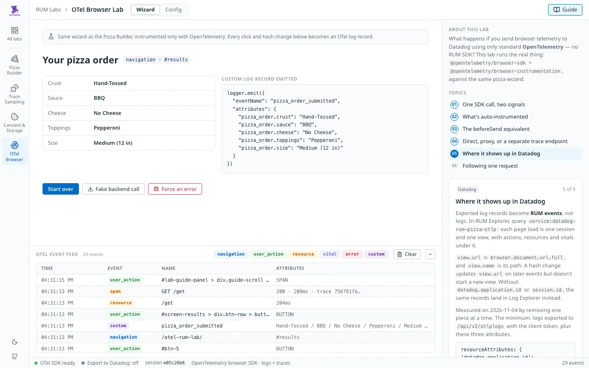
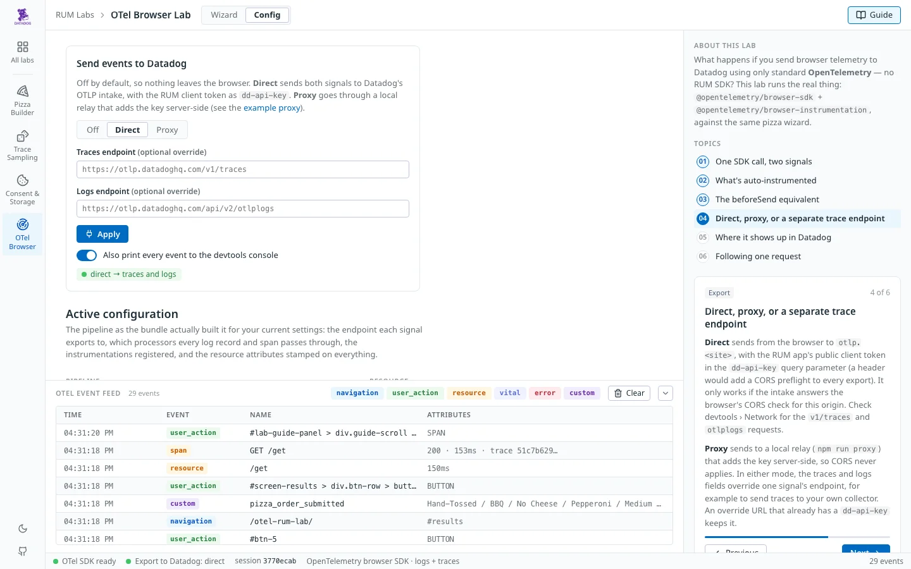
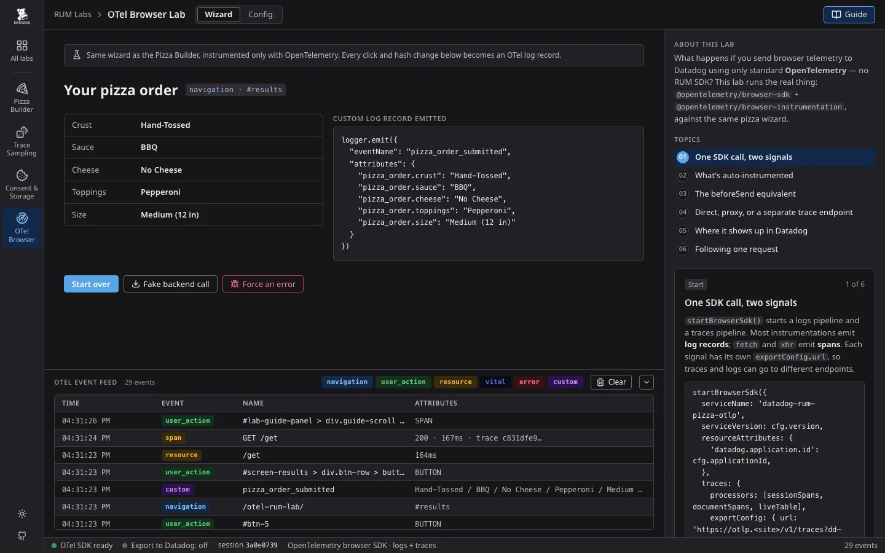

# 🔬 OTel Browser → Datadog RUM Lab

An experimental companion to the [Pizza Builder](../pizza-builder-lab/) demo, exploring a different question: instead of the `datadog-rum` browser SDK, what happens if you send browser telemetry to Datadog using only **standard OpenTelemetry** — the official [`@opentelemetry/browser-instrumentation`](https://github.com/open-telemetry/opentelemetry-browser) package with stock auto-instrumentation, exported over OTLP?

This is exploratory and educational, runs entirely as static files (this whole page works standalone, including on GitHub Pages, with zero backend required), and isn't a statement about what Datadog does or doesn't support — it's a hands-on look at the moving pieces involved in getting a browser OTel pipeline talking to Datadog at all, run against the same pizza wizard flow as the main demo so the two are easy to compare.







## The basic pattern

```
Browser
 ├─ @opentelemetry/browser-instrumentation
 │    navigation, clicks, errors, web vitals, resource timing, console → log records
 │    fetch, xhr                                                       → spans
 ├─ @opentelemetry/browser-sdk  startBrowserSdk({ traces, logs })
 │    ├─ session + document processors (stamp session.id, browser.document.url.full)
 │    ├─ live-table processors → the docked log, before export
 │    └─ OTLP exporters, one endpoint per signal (off by default)
 │
 ├─ Direct:  https://otlp.<site>/v1/traces?dd-api-key=<client token>
 │           https://otlp.<site>/api/v2/otlplogs?dd-api-key=<client token>
 └─ Proxy:   your local proxy (proxy/server.js) adds the key server-side
```

The whole pipeline is one call, built from `window.DD_CONFIG` (`../config.js`, the same settings every lab reads):

```javascript
startBrowserSdk({
  serviceName: 'datadog-rum-pizza-otlp',
  serviceVersion: cfg.version,
  resourceAttributes: {
    'datadog.application.id': cfg.applicationId,
    'deployment.environment.name': cfg.env,
  },
  instrumentations,
  traces: {
    processors: [createSessionSpanProcessor(session), createDocumentSpanProcessor(doc), new LiveTableSpanProcessor()],
    exportConfig: { url: `https://otlp.${cfg.site}/v1/traces?dd-api-key=${cfg.clientToken}` },
  },
  logs: {
    processors: [createSessionLogRecordProcessor(session), createDocumentLogRecordProcessor(doc), new LiveTableLogProcessor()],
    exportConfig: { url: `https://otlp.${cfg.site}/api/v2/otlplogs?dd-api-key=${cfg.clientToken}` },
  },
});
```

`doc` is `createLocationDocumentProvider()` from `@opentelemetry/browser-sdk/document`. It gives every log and span `browser.document.url.full`, the page the user was on, which is separate from `url.full` (what the event is about: the navigated-to URL, the fetched resource).

When a signal has `processors`, the SDK uses them and, only if `exportConfig` is set too, appends a `BatchLogRecordProcessor` / `BatchSpanProcessor` with the OTLP exporter. So "export off" just means leaving `exportConfig` out.

### Export modes

Picked on the **Config** tab, which writes them to the URL and reloads (the SDK starts once per page):

| URL | Traces go to | Logs go to |
|---|---|---|
| *(none)* | nowhere | nowhere |
| `?export=direct` | `https://otlp.<site>/v1/traces?dd-api-key=<client token>` | `https://otlp.<site>/api/v2/otlplogs?dd-api-key=<client token>` |
| `?export=proxy&proxy=http://localhost:8791` | `<proxy>/v1/traces` | `<proxy>/v1/logs` |
| add `&traces=<url>` and/or `&logs=<url>` | that URL | that URL |

`<site>` is `DD_CONFIG.site`, or `?site=` to try another (e.g. `?site=datad0g.com`). In direct mode the client token is appended to override URLs as well, unless the URL already has its own `dd-api-key`.

The key goes in the query string rather than a `dd-api-key` header because a custom header makes every export a CORS preflight. Tested from `localhost` on 2026-11-04: with the real client token, both `otlp.datadoghq.com` paths answered the browser's export `POST` with `200`. An earlier version of this lab found no CORS support on the intake and required the proxy; if direct export fails for you, check devtools › Network for the two requests and use the proxy instead.

## What Datadog needs

Measured on 2026-11-04 against the shared RUM application, from `localhost`, by sending one short session per variant and then searching RUM Explorer and Log Explorer for it. Each variant removes one piece from the minimal config below:

| Variant | RUM events for the session | Where the records went |
|---|---|---|
| Minimal config, as below | session, view, actions, vitals | RUM |
| No `datadog.application.id` | none | Log Explorer |
| No session processor (no `session.id`) | none | Log Explorer |
| No document processor (no `browser.document.url.full`) | session, view, actions, vitals, all without `view.url` | RUM |
| No traces (`startLogsSdk()` only) | session, view, actions | RUM |

So the minimum for RUM sessions and views is a logs pipeline exported to `/api/v2/otlplogs` with the client token, plus three attributes: `datadog.application.id`, `session.id` and `browser.document.url.full`. Traces aren't needed for any of it.

What the records turn into:

- The exported log records become RUM events (`session`, `view`, `action`, `resource`, `vital`) under the record's `service.name`. Query `service:datadog-rum-pizza-otlp` in RUM Explorer.
- `view.url` is `browser.document.url.full`, split into `url_path`, `url_query` and `url_hash`. `view.name` is the path (`/otel-rum-lab/`).
- One view per page load. A hash change (`#crust` → `#sauce`) updates `view.url` on later events, but doesn't start a new view.

### Minimal config

This is the config the "minimal" row ran, minus the switches used to drop pieces:

```javascript
import { startBrowserSdk } from '@opentelemetry/browser-sdk';
import {
  createSessionManager,
  createDefaultSessionIdGenerator,
  createLocalStorageSessionStore,
  createSessionLogRecordProcessor,
  createSessionSpanProcessor,
} from '@opentelemetry/browser-sdk/session';
import {
  createLocationDocumentProvider,
  createDocumentLogRecordProcessor,
  createDocumentSpanProcessor,
} from '@opentelemetry/browser-sdk/document';
import { NavigationInstrumentation } from '@opentelemetry/browser-instrumentation/experimental/navigation';
import { UserActionInstrumentation } from '@opentelemetry/browser-instrumentation/experimental/user-action';
import { WebVitalsInstrumentation } from '@opentelemetry/browser-instrumentation/experimental/web-vitals';
import { FetchInstrumentation } from '@opentelemetry/instrumentation-fetch';

const { applicationId, clientToken, site } = window.DD_CONFIG;

// session.id — required. Without it, records land in Log Explorer, not RUM.
const sessionManager = createSessionManager({
  sessionIdGenerator: createDefaultSessionIdGenerator(),
  sessionStore: createLocalStorageSessionStore(),
});
await sessionManager.start();

// browser.document.url.full — becomes view.url / view.name.
const documentProvider = createLocationDocumentProvider();

startBrowserSdk({
  serviceName: 'my-app',
  // Required. Without it, records land in Log Explorer, not RUM.
  resourceAttributes: { 'datadog.application.id': applicationId },
  instrumentations: [
    new NavigationInstrumentation(),
    new UserActionInstrumentation(),
    new WebVitalsInstrumentation(),
    new FetchInstrumentation({ ignoreUrls: [/otlp\./] }),
  ],
  logs: {
    processors: [
      createSessionLogRecordProcessor(sessionManager),
      createDocumentLogRecordProcessor(documentProvider),
    ],
    exportConfig: { url: `https://otlp.${site}/api/v2/otlplogs?dd-api-key=${clientToken}` },
  },
  traces: {
    processors: [
      createSessionSpanProcessor(sessionManager),
      createDocumentSpanProcessor(documentProvider),
    ],
    exportConfig: { url: `https://otlp.${site}/v1/traces?dd-api-key=${clientToken}` },
  },
});
```

Two notes:

- **`startBrowserSdk()` always starts the traces SDK.** Leave `traces` out and it still exports spans, to the default `http://localhost:4318/v1/traces`. For logs only, call `startLogsSdk()` from `@opentelemetry/browser-sdk/logs` with the `logs` options above instead.
- **This lab's own config is bigger on purpose.** It adds the live log, console exporters, the sandbox's full instrumentation list, an end-on-demand session (`src/session.js` instead of `createSessionManager()`) and URL cleaning. None of that is needed for Datadog.

## The live event table

The most reusable piece of this lab, independent of Datadog: a `LogRecordProcessor` (and a matching `SpanProcessor`) registered *ahead of* the OTLP export processor. Every log and span, whether it came from stock auto-instrumentation (a click, a navigation change, a fetch) or from something the app emitted on purpose, passes through it before export:

```javascript
export class LiveTableLogProcessor {
  onEmit(logRecord) {
    renderRow(logRecord.eventName, logRecord.attributes);
  }
  // forceFlush / shutdown required by the LogRecordProcessor interface
}
```

This is the direct OpenTelemetry equivalent of the RUM SDK's `beforeSend` callback that powers the event log table in the main demo — same idea, different SDK, and it feeds the same shared docked log (`LabLog` in `../lab-shared.js`) every other lab uses, for the same reason: this should read as the same site, not a one-off page.

Every log record and span also prints to the devtools console via `ConsoleLogRecordExporter` / `ConsoleSpanExporter` — the same one the [official getting-started guide](https://opentelemetry.io/docs/languages/js/getting-started/browser/) uses. Toggle it from the **Config** tab.

One filtering note carried over from the main demo: `ResourceTimingInstrumentation` fires for every asset the page loads (stylesheets, fonts, icons), so it's limited to `fetch`/`xhr` initiators and the table only surfaces real network calls rather than every static asset — same fix, same reason, as the pizza builder's own resource-event filtering.

## What this app instruments

| Wizard behavior | Instrumentation | Event name |
|---|---|---|
| Hash change (`#crust`, `#sauce`, …) | `NavigationInstrumentation` (patches `history.pushState`/`popstate`/hash changes automatically) | `browser.navigation` |
| Any click | `UserActionInstrumentation` | `browser.user_action.click` |
| Page load | `NavigationTimingInstrumentation` (the `PerformanceNavigationTiming` entry, once it's complete) | `browser.navigation_timing` |
| Core Web Vitals | `WebVitalsInstrumentation({ includeRawAttribution: true })`; the web-vitals attribution object is the record body | `browser.web_vital` |
| "Fake backend call" button | `FetchInstrumentation` from `@opentelemetry/instrumentation-fetch` (client span, `traceparent` on every cross-origin request, `clearTimingResources`) | span `GET` |
| "Fake backend call" button | `ResourceTimingInstrumentation` (observes the Resource Timing API passively) | `browser.resource_timing` |
| "Force an error" button | `ErrorsInstrumentation` (listens for `window.onerror` / `unhandledrejection`) | `exception` |
| `console.warn` / `console.error` | `ConsoleInstrumentation` | `browser.console` |
| Final submit | a custom log event we emit ourselves | `pizza_order_submitted` |
| Which page each event happened on | `createLocationDocumentProvider()` + the SDK's document processors: `location.href` at emit time (span start for spans), with this page's own `?export=…` settings stripped by `sanitizeUrl` (an override URL there can carry a `dd-api-key`). A small log processor strips the same settings from `url.full` on `browser.navigation` / `browser.navigation_timing` | `browser.document.url.full` on everything |
| Session lifecycle | our own session-id tracking (`src/session.js`), modeled on the RUM SDK's session rules, fed to the SDK's session processors | `session.start` / `session.end`, `session.id` on everything |

Everything above the last two rows is stock instrumentation, nothing hand-rolled. The list and options match the official [sandbox](https://github.com/open-telemetry/opentelemetry-browser/blob/main/sandbox/src/otel.ts), which is why fetch and XHR come from the opentelemetry-js contrib packages (`instrumentation-fetch`, `instrumentation-xml-http-request`) rather than `browser-instrumentation`'s own experimental ones. Two additions on top of the sandbox: `NavigationInstrumentation` and `ConsoleInstrumentation`, and `ResourceTimingInstrumentation` keeps `initiatorTypes: ["fetch", "xmlhttprequest"]`. `XMLHttpRequestInstrumentation` is registered too, though nothing on the page uses XHR. The session id comes from our own provider rather than the SDK's `createSessionManager()` because the wizard's "Start over" ends the session on demand, which the SDK's manager doesn't expose.

## What's not included

- **Backend trace correlation.** The fetch span's `traceparent` reaches `httpbin.org`, which echoes it back, but no traced backend is on the other end.
- **The sandbox's other trace settings.** It also sets `batchProcessorConfig`, a `StackContextManager` and W3C trace-context + baggage propagators; this lab uses the SDK's defaults for those.
- **Anything about Datadog's mapping beyond what [What Datadog needs](#what-datadog-needs) measured.** That's one org on one day; re-run the check before relying on it. Span mapping wasn't checked.

## Running locally

This page shares its CSS/JS chrome (`druids-tokens.css`, `tokens.css`, `lab-shared.css`, `lab-shared.js`, `labs.json`) with the rest of the site via `../` paths — the same way `../consent-lab/` does — so **serve from the repo root**, not from inside this directory, or those requests 404.

```bash
npm install                  # from the repo root — one package.json builds every lab
npm run dev                  # bundles src/main.js → dist/bundle.js on change, serves the repo root
# open http://localhost:8765/otel-rum-lab/
```

Click through the wizard — the live event table fills in immediately, no proxy or API key required.

To send events to Datadog, pick **Direct** on the **Config** tab. It uses `applicationId`, `clientToken` and `site` from the root `config.js` (`cp config.template.js config.js`).

To go through the proxy instead: copy `otel-rum-lab/.env.example` to `.env`, fill in the two endpoints and a key in the `dd-api-key` slot (the RUM app's client token works), run `npm run proxy` from the repo root in a second terminal, then pick **Proxy** on the **Config** tab (defaults to `http://localhost:8791`).

## Deployment

`dist/` is gitignored — it's a build output, not source. The repo's root `npm run build` bundles this lab along with every other environment, and the GitHub Pages workflow runs it before publishing, so the committed source is all that needs to exist; the bundle is generated fresh on every deploy.

## Stack

- [`@opentelemetry/browser-sdk`](https://github.com/open-telemetry/opentelemetry-browser/tree/main/packages/sdk) — `startBrowserSdk()` and the session processors
- [OpenTelemetry JS SDK](https://opentelemetry.io/docs/languages/js/getting-started/browser/) — `sdk-logs`, `sdk-trace` (console exporters) and `api-logs`
- [`@opentelemetry/browser-instrumentation`](https://github.com/open-telemetry/opentelemetry-browser) — the official browser event instrumentations
- `@opentelemetry/instrumentation-fetch`, `@opentelemetry/instrumentation-xml-http-request` — client spans for network calls
- [Datadog OTLP ingest](https://docs.datadoghq.com/opentelemetry/setup/otlp_ingest/) — public docs on sending OTLP directly to Datadog
- esbuild — bundles the npm-only OTel packages into `dist/bundle.js`
- `app.js` — plain, unbundled page UI (wizard, event feed, the export form), loaded *before* the bundle so `window.otelLab.logEvent` / `logSpan` exist by the time events start arriving. Same split as `../pizza-builder-lab/app.js` and `../consent-lab/app.js`: OTel setup only in the bundle, everything about how the page looks and behaves lives here instead
- `../lab-shared.js`, `../lab-shared.css` and the DRUIDS tokens — the shared shell (rail, tabs, guide, docked log, status bar); this lab supplies content, not chrome
- A minimal Node proxy: optional, for when direct export isn't an option
