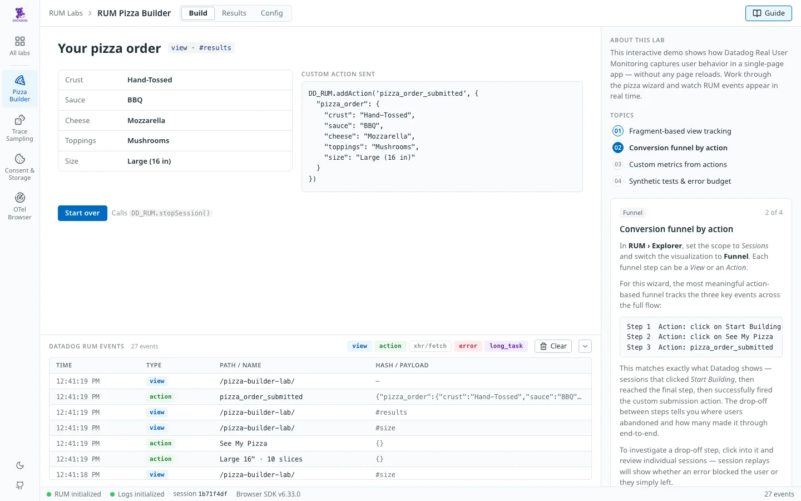

# RUM Pizza Builder

**[Try it →](%%PAGES_URL%%/pizza-builder-lab/)**

The original demo in this repo: a five-step pizza order wizard that shows how Datadog RUM captures views, actions and users in a single-page app, without page reloads. It used to be the site's home page at `/`. It now lives at `/pizza-builder-lab/`, and `/` is the All labs page.




## What it demonstrates

- **Fragment-based views.** Each step sets `location.hash` (`#crust` › `#sauce` › `#cheese` › `#toppings` › `#size` › `#results`), and the RUM SDK records each as its own View. The step tracker and the `view · #crust` tag on each step show the hash that view gets.
- **Actions and a custom action.** Clicks are captured automatically. *Start building* and *See my pizza* carry `data-dd-action-name` (`Start Building`, `See My Pizza`) so the funnel's action names stay stable. The results screen fires `DD_RUM.addAction('pizza_order_submitted', { pizza_order })` and shows the exact payload it sent.
- **Users.** At submission the page calls `DD_RUM.setUser()` (and sometimes `setAccount()`) with a generated identity whose ID is a hash of name and email, so the same fictional customer keeps the same ID across sessions.
- **Session lifecycle.** *Start over* calls `DD_RUM.stopSession()`. The status bar's session ID changes on your next click.
- **`beforeSend`.** Every event passes through `beforeSend`, which feeds the docked log (resources are limited to `xhr`/`fetch`; the *xhr/fetch* filter is off by default) and still returns `true`, so everything reaches Datadog.
- **Synthetics.** A scheduled Browser Synthetic test runs the wizard. For the `DatadogSynthetics` user agent (or `?synthetic`), option order is shuffled per run, and on a share of runs (by region, from the Fastly POP) a simulated error is injected at a random step to produce realistic funnel drop-off. `?force_session_type=user` clears the Synthetics context before the SDK loads.

The guide panel has the matching Datadog walkthroughs: the `@view.url_hash` query, the action funnel, the `rum.pizza_order.submissions` metric and the SLO.

## Tabs

| Tab | What's on it |
| --- | --- |
| Build | The wizard |
| Results | The embedded "Pizza Order Submissions" dashboard (loaded the first time the tab opens) |
| Config | The RUM and Logs options as each SDK reports them (`getInitConfiguration()`, client token masked) |

## Running it

From the repo root:

```bash
cp config.template.js config.js   # fill in applicationId + clientToken
npm run dev                        # http://localhost:8765/pizza-builder-lab/
```

Add `?synthetic` to the URL to exercise the Synthetics code path in a normal browser.

## Caveats

- **Moving from `/`.** The All labs page forwards old `/#<step>` links, and any request from the Synthetics user agent (or with `?synthetic` / `force_session_type`), here. Datadog views and the Synthetic test's recorded URL now show `/pizza-builder-lab/`; update the test's start URL and any saved Explorer queries that filter on `@view.url_path:/`.
- `pops.json` (Fastly POP regions) and `fake-data.json` (fake customer identities) are fetched relative to this page, so they live in this directory.
