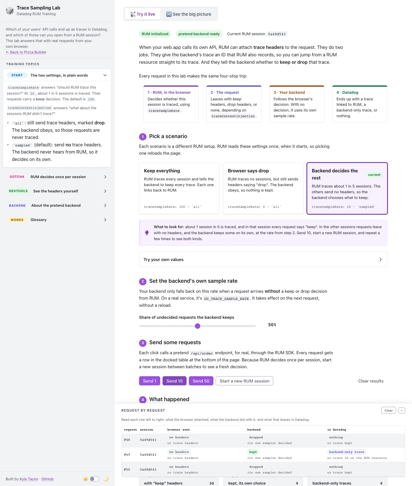
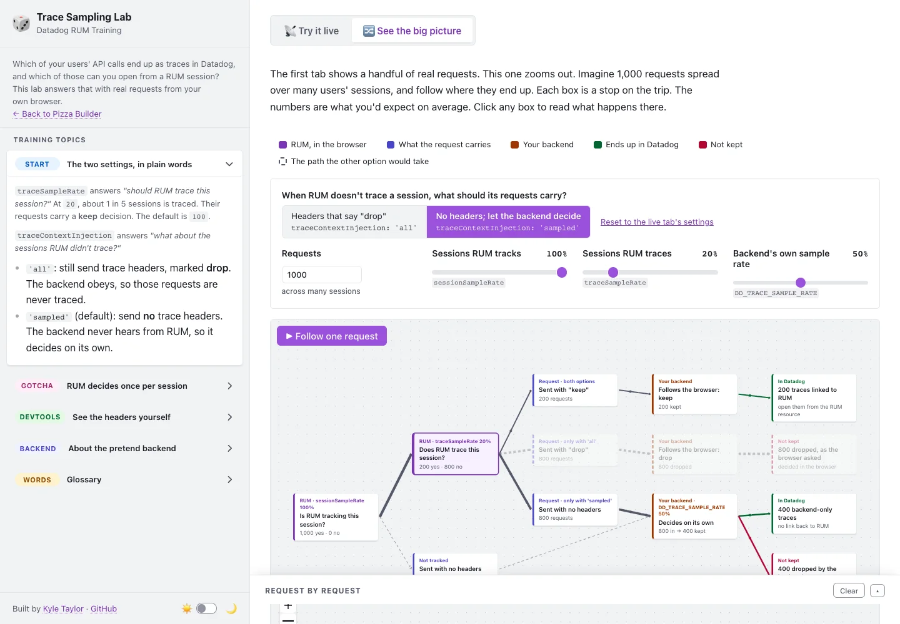

# 🎲 Trace Sampling Lab

A companion to the [Pizza Builder](../pizza-builder-lab/) demo for a recurring question: with RUM connected to APM, **which browser requests end up as traces in Datadog, and which of those link back to RUM?** Two RUM options decide it, and they interact with whatever sampling the backend does:

| Option | Default (v6) | What it does |
| --- | --- | --- |
| `traceSampleRate` | `100` | Share of traced requests RUM marks as sampled (keep) |
| `traceContextInjection` | `'sampled'` | `'all'`: inject headers on every traced request, with priority 0 on unsampled ones. `'sampled'`: inject only on sampled requests, so the backend decides the rest |

Both only apply to URLs in `allowedTracingUrls`, and only inside a tracked RUM session.





## How it works

```
Browser
 ├─ RUM SDK (CDN, v6), allowedTracingUrls: ./api/*, propagatorTypes: datadog + tracecontext
 │    traceSampleRate / traceContextInjection from the query string (?tsr=&tci=)
 ├─ fetch('./api/order?req=N&apm_rate=A')
 │        │  real request, real headers — visible in devtools › Network
 │        ▼
 │   sw.js — the simulated backend tracer (service worker)
 │     upstream decision present → honor it (keep on 1, drop on 0)
 │     no decision               → new root trace, head-sample at apm_rate%
 │        │
 │        ▼  JSON: headers received, keep/drop, who decided, trace ID
 └─ beforeSend on the RUM resource event
      → compares its _dd.trace_id to the trace the backend kept ("linked")
```

What's **measured**: the headers the RUM SDK injected, and the `_dd.trace_id` (or its absence) on RUM's resource event. What's **simulated**: only the backend tracer's decision. See [`sw.js`](sw.js).

## Things this lab shows

- **The decision is per session, not per request.** In SDK v6 the tracer calls `isSampled(session.id, traceSampleRate)`, a Knuth-factor hash of the session ID that is cached per rate. At `traceSampleRate: 20`, one session sends `x-datadog-sampling-priority: 1` on *every* request or on *none*. You only see ~20% across many sessions. Use **Start a new RUM session** between batches, and the Sessions table shows one outcome per session.
- **`'all'` hands the backend a drop.** Unsampled requests still carry the full header set, with `x-datadog-sampling-priority: 0`, `traceparent …-00` and `tracestate dd=s:0;o:rum`. A tracer honors that and drops the trace, so the backend's own rate never applies. RUM's resource event carries no `_dd.trace_id` for these requests either.
- **`'sampled'` hands the backend the decision.** Unsampled requests reach the backend with no trace headers at all. Its head sampler keeps some of them as **backend-only** traces, which have no RUM resource to link to.
- **Linked traces depend only on the RUM side.** Across many sessions, traces linked to RUM = requests × `sessionSampleRate` × `traceSampleRate`. The backend rate changes how many *other* traces you get, never how many link back to RUM.
- **Untracked sessions inject nothing.** If `sessionSampleRate` leaves a session untracked, its requests get no headers in either mode. The *See the big picture* tab models this (the live page tracks 100% of sessions).

## Running it

```bash
npm install
cp config.template.js config.js   # fill in applicationId + clientToken
npm run dev                        # http://localhost:8765/trace-sampling-lab/
```

Service workers need `https` or `localhost`, so this doesn't work from `file://`. The page waits for the worker to take control before enabling the Send buttons. A hard reload (shift+reload) bypasses the worker, and the page asks it to reclaim control.

The flow diagram is `src/SamplingFlow.jsx`, bundled to `dist/bundle.js` with ReactFlow (`@xyflow/react`). ReactFlow's stylesheet comes from jsDelivr, pinned to the same exact version as `package.json`. Bump both together.

## Caveats

- **The backend is a model.** Real Datadog tracers also have error and rare samplers that can keep some priority-0 traces, and by default the Agent computes rates itself (a target of 10 traces per second per Agent) rather than using one flat `DD_TRACE_SAMPLE_RATE`. Ingestion controls and retention filters then apply on top. Check the trace pipeline docs before quoting numbers to a customer.
- **Counts on the *See the big picture* tab are expected values** across many sessions. Any single session is all-or-nothing.
- **An ad blocker that blocks `datadoghq-browser-agent.com`** stops the RUM SDK from loading, so no headers are injected and the backend samples everything itself. The page says so when that happens.

## References

- [Connect RUM and Traces](https://docs.datadoghq.com/real_user_monitoring/correlate_with_other_telemetry/apm/)
- [Ingestion Mechanisms](https://docs.datadoghq.com/tracing/trace_pipeline/ingestion_mechanisms/)
- [Correlate RUM and Traces (OpenTelemetry)](https://docs.datadoghq.com/opentelemetry/correlate/rum_and_traces/)
